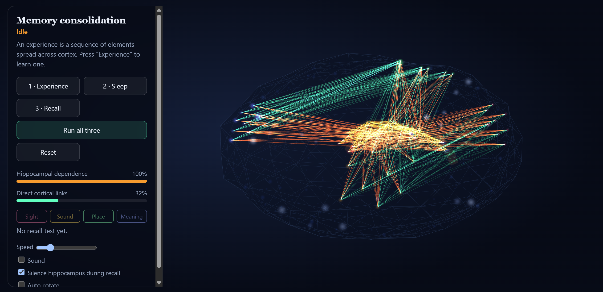

# Memory consolidation simulator

Browser-based 3D spiking-network model of systems consolidation.

    npm install
    npm run dev      # http://localhost:5173
    npm test         # vitest
    npm run build

Flow: **Experience** (encode) → **Sleep** (hippocampal replay builds direct cortical links) → **Recall**
(cue the first element; with the hippocampus silenced, only a consolidated memory completes the sequence).
Enable **Sound** to hear the memory as a four-note motif; replay plays it back time-compressed.

Files: `src/sim.ts` (LIF network + plasticity, no DOM), `src/layout.ts` (geometry), `src/scene.ts` (three.js),
`src/audio.ts` + `src/scale.ts` (Web Audio), `src/main.ts` (UI loop).
